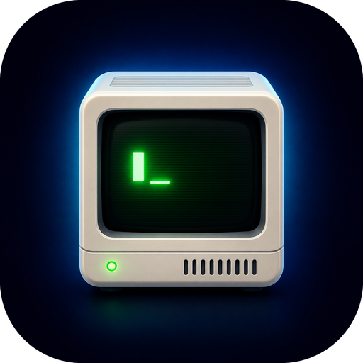
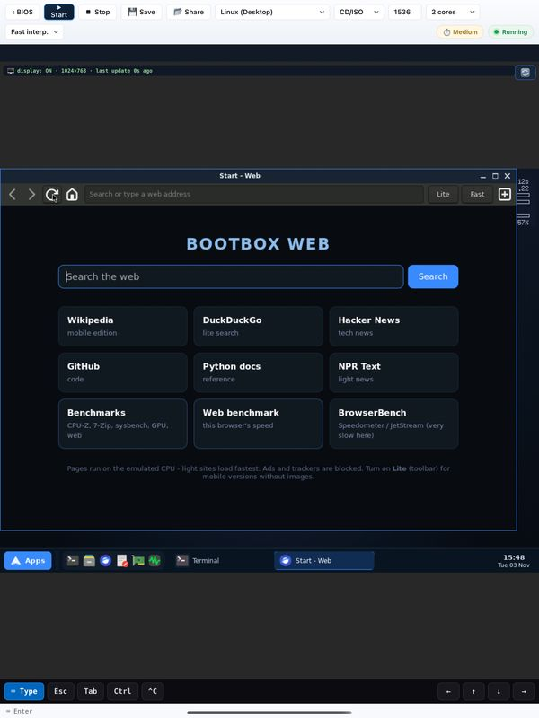
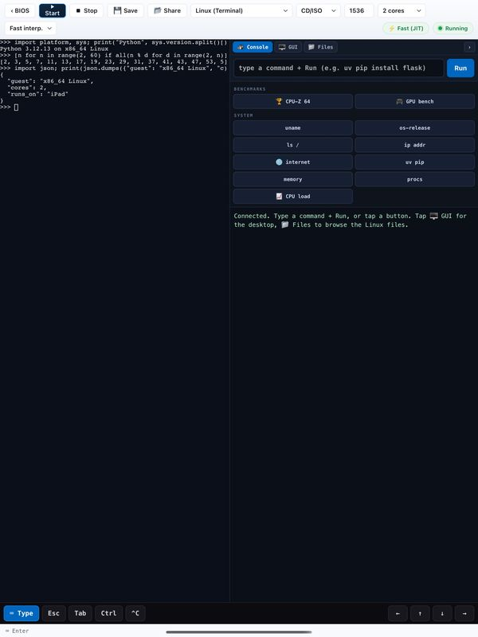
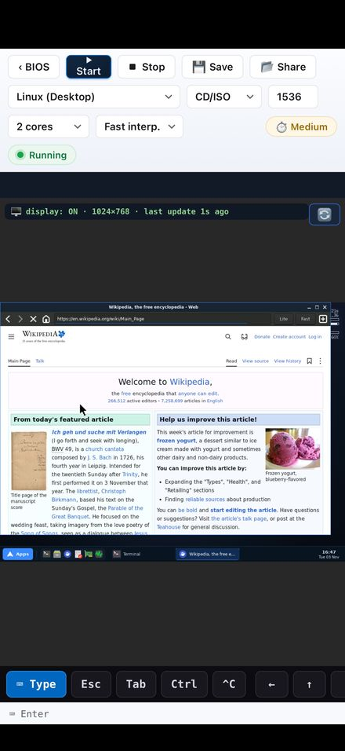
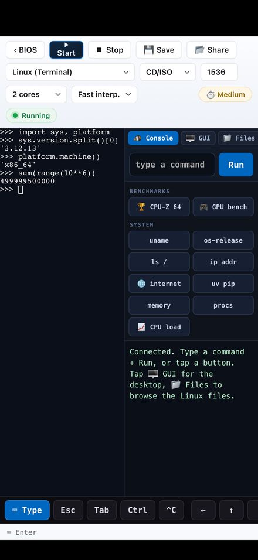
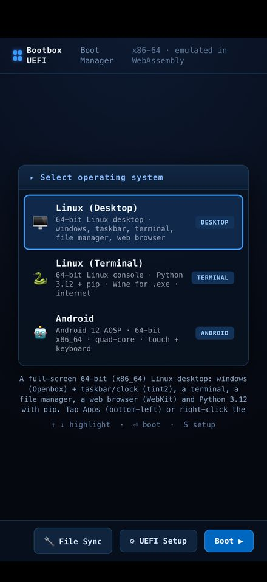

# Bootbox

<p align="center">
  
</p>

<p align="center">
  A virtual PC for iPad and iPhone. It boots real 64-bit <b>Linux</b> (a desktop with a WebKit browser,
  or a terminal with Python 3.12 and Wine) and <b>Android 12</b> on a complete x86-64 computer emulated
  on-device in WebAssembly, with real internet, real multi-core and your files in the Files app.
  No jailbreak, no servers, no sign-in.
</p>

<p align="center">
  <a href="https://apps.apple.com/app/id6782149582"></a>
</p>

<p align="center">
  <a href="https://apps.apple.com/app/id6782149582"></a>
  
  
  
  
  
</p>

<p align="center">
  
  
</p>
<p align="center">
  
  
  
</p>

<p align="center">
  <a href="#what-it-boots">What it boots</a> ·
  <a href="#performance">Performance</a> ·
  <a href="#feature-highlights">Features</a> ·
  <a href="#building-the-app">Build</a> ·
  <a href="#engineering-notes-the-fun-bugs">Engineering notes</a> ·
  <a href="#privacy">Privacy</a>
</p>

---

## How it works

Bootbox emulates a whole x86-64 PC in software: QEMU's CPU emulator is compiled to WebAssembly
and runs inside a `WKWebView`, so WebKit's own JIT turns guest code into native code. There is
no Hypervisor.framework or JIT entitlement on iOS, and Bootbox needs neither. Every guest
instruction is translated in software, which makes it far slower than a real computer; it's
built for learning Linux, scripting, retro computing and experiments.

```
┌────────────────────────────────────────────────────────────┐
│  iPad / iPhone (iOS)                                       │
│  ┌──────────────────────────────────────────────────────┐  │
│  │ Bootbox.app (Swift)                                  │  │
│  │  HostView ── WKWebView (cross-origin isolated)       │  │
│  │  LocalServer       · in-app HTTP w/ COOP/COEP + gzip │  │
│  │  Iosnet.xcframework · gVisor netstack → real TCP/IP  │  │
│  │  BinaryBridge/Downloader · guest images on demand    │  │
│  │  FileProviderExtension   · guest files in Files.app  │  │
│  │  ┌────────────────────────────────────────────────┐  │  │
│  │  │ web/ — the "firmware" UI (boot menu + UEFI     │  │  │
│  │  │ setup) and the engines:                        │  │  │
│  │  │  · QEMU-Wasm x86-64 (SMP, ACPI, virtio, 9p)    │  │  │
│  │  │  · QEMU-Wasm aarch64 (ARM64, not in the menu)  │  │  │
│  │  │  · v86 (32-bit x86: your own images and ISOs)  │  │  │
│  │  │  · Boxedwine (Wine in the browser)             │  │  │
│  │  │  · noVNC (Linux desktop + direct Android UI)   │  │  │
│  │  └────────────────────────────────────────────────┘  │  │
│  └──────────────────────────────────────────────────────┘  │
└────────────────────────────────────────────────────────────┘
```

---

## What it boots

| System | Arch | Cores | Highlights | Download |
|---|---|---|---|---|
| **Linux (Desktop)** | x86-64 | **1–8 (default 2)** | Openbox + tint2 desktop · **WebKit web browser** (links can also open in the device's own browser) · PCManFM · terminal · Python 3.12 · **Benchmarks hub** (CPU-Z, 7-Zip, sysbench, glmark2, web) | ~240 MB, once |
| **Linux (Terminal)** | x86-64 | **1–8 (default 2)** | Alpine · Python 3.12 + pip · real internet · file browser · `mc` · **wine-staging 11.5, esync on by default, warm prefix** | ~310 MB, once |
| **Android 12 AOSP** | x86-64 | 4 | Full Android framework + ART · System UI · Launcher3 · touch/keyboard · resumes from a home-screen snapshot in seconds · writable `/data` | ~900 MB, once |
| **Your own images** | i686 (v86) | 1 | Import `.iso`/`.img` (for example your own Windows install media) via the Files app; paired save-states resume in ~1 s | — |

The **app itself is ~68 MB.** Guest images are **not bundled** — each system downloads
once from GitHub Releases and is cached (delete it in the Files app to reclaim space). The
64-bit engines ship inside the app, but the multi-hundred-MB rootfs images (and the ARM64
engine, which few users boot) are fetched on demand.

---

## Performance

Measured on an Apple M4 Mac with the engine the app ships (Linux guest, 4 vCPUs), in Chrome's and
in WebKit's WebAssembly engines. iPads land in the same range or somewhat lower.

| Benchmark | Score |
|---|---|
| CPU-Z, single / multi thread | **15.4 / 42.0** (WebKit: 12.0–12.7 / 29–31) |
| 7-Zip, single / multi thread | **301 / 907** MIPS |
| GPU: glmark2 on Mesa llvmpipe (every pixel drawn by the emulated CPU) | **45** |
| Web benchmark in the Linux browser (1000 = WebKit natively on an M4) | **4–7** |
| Android 12 cold app launch: Settings / Contacts | **21 s / 15 s** |

For scale: a modern native CPU core scores roughly 700–900 in CPU-Z single-thread, so the emulated PC
runs at a few percent of native. A month earlier the same CPU-Z test scored 0.59 / 1.48. What made
the difference, build by build:

- **Compiled blocks no longer wait for the garbage collector** (Build 85). Evicted block instances
  stayed counted against the live-instance cap until JavaScript's GC ran, so big guests quietly ran
  fully interpreted. CPU-Z ×18, glmark2 ×8.
- **Registers in wasm locals, SSE float ops as native wasm, chained blocks** (Builds 86–93).
- **Compile threshold 10,000 on iPad** (Build 99). WebKit pays a costly module compile per block,
  so first-run code (opening apps and menus, booting) got 2–4× faster.
- **Lazy wasm modules** (Build 107). Every translated block stored a wasm module, so the 256 MB
  translation cache filled and flushed every ~8 s. A block now gets its module only once it's hot:
  CPU-Z +16% single / +32% multi; Android app launches ~30% faster.
- **16-byte atomics without stopping the world** (Build 108). Every guest kernel allocation used to
  freeze all vCPUs.
- **No longjmp per run of blocks that touch a device** (Build 109): sticky block splits at mid-block
  MMIO; APIC recompiles fell from 541,738 to 13 per CPU-Z run.
- **WebKit-only hot spots** (Builds 110–111), found by sampling WebKit itself: wasm table growth
  one slot at a time, `performance` lookups, and a 43 KB call switch WebKit's optimizing compiler
  chewed on for seconds during every boot.
- **Fast interpreter by default** (Build 112). A compact interpreter loop WebKit can fully
  optimize; the classic one sometimes stayed slow (2 of 3 test runs were 3–4× slower).

---

## Feature highlights

### A Linux desktop with a real browser
The Desktop system boots straight to an **Openbox** desktop with a **tint2** taskbar: tap **Apps**
(bottom left) or right-click / long-press the desktop for programs. It comes with a terminal, the
**PCManFM** file manager, a text editor, Python 3.12, a system monitor and **bbweb**, a WebKitGTK
browser tuned for emulation (one web process, the mimalloc allocator, an ad blocker, Lite and Fast
page modes). bbweb runs real sites such as Wikipedia, DuckDuckGo and GitHub inside the emulated PC.
Its **Web** icon can also hand a page to the device's own browser, which is far faster, with a
**Back to Linux** button.

A **Benchmarks hub** runs CPU-Z (the real Windows program, under Wine), 7-Zip, sysbench, glmark2 and
a web benchmark, singly or with **Run all**, and keeps a history you can screenshot.

### Real multi-core (x86-64, up to 8 cores) — and it *actually* parallelizes
The x86-64 console guest boots **dual-core by default** (`nproc` = 2) and scales to **8**.
This is genuine parallelism, not a cosmetic core count: each vCPU is its own WebAssembly
worker running MTTCG, and a direct measurement (four CPU spinners for 8 s wall-clock,
integrating `/proc/stat`) shows the guest accruing **~4 cores' worth of CPU-time at
`-smp 4`** — i.e. ~4× throughput on parallel work (builds, `numpy`, compiles). A busy
program no longer freezes the shell.

Pick the count in the emulator toolbar (also in UEFI Setup → Advanced). Because a live
WebAssembly engine **cannot be re-instantiated in place** (its pthread workers and shared
memory are one-shot), changing cores or RAM **cleanly reloads the page and auto-resumes the
guest** with the new setting — so the selector always takes effect (an earlier build could
get "stuck" at the first boot's core count). More cores run genuinely faster **and hotter**
under load, since each core is a full software-emulated CPU — the selector is an honest
speed/heat knob: **1 = coolest, 2 = balanced, 4–8 for heavy parallel compute.**

### Cooling: three independent wins
Every guest instruction is software-translated by WebKit's WASM JIT — there's no
Hypervisor.framework on iOS, so the translation *is* the heat. Bootbox attacks it three ways:

1. **Idle busy-poll → futex sleep (engine).** Emscripten's `poll()` returns immediately
   regardless of timeout, so QEMU's `qemu_poll_ns()` degenerated into a busy-spin — **~1.2
   host cores at an idle shell prompt.** The patched engine polls non-blocking and sleeps
   the *remaining* timeout on a real zero-CPU futex in adaptive 1→8 ms slices. Idle host CPU
   **~120% → ~32%**, and boot/parallel workloads got *faster* (the spin had been starving
   the vCPU threads).
2. **Tickless guest kernels.** The guest kernels are built `NO_HZ_IDLE` + `HIGH_RES_TIMERS`,
   so an idle CPU stops taking the 100 Hz scheduler tick — under emulation each avoided tick
   is an emulated LAPIC IRQ + TB execution + a worker wake-up saved. Combined with the futex
   engine, **idle drops to ~3–6% host CPU.**
3. **Stripped engine binaries (`-g`).** The shipped engines were compiled with `-g`, which
   embedded full DWARF debug info — that was the *bulk* of the binary. Dropping it for
   release cut **x86-64 41.2 MB → 11.4 MB** and **aarch64 55.7 MB → 15.5 MB (−72%)** with
   byte-identical codegen (same `-O3`) — so zero runtime-speed cost, just far less to fetch,
   parse, instantiate and keep resident (~30 MB less memory per engine), and lower WebKit JIT
   pressure. Cooler startup, cooler idle, a smaller app.

Under *sustained* heavy load, heat is `N_cores × cost-per-instruction × duty-cycle` — you
can't make an emulated instruction cheap, so the honest levers are fewer cores / less
duty-cycle (hence the cores knob above). The three wins here cut everything *around* the
core emulation: idle, startup, memory, and the engine tax.

### Full Android 12 on iPadOS

The Android option is a real **64-bit x86-64 AOSP userspace**, not the older JavaScript
APK compatibility harness. Android init, Binder/HwBinder/VndBinder, ART, Package Manager,
System UI and Launcher3 all run inside Bootbox's full-system QEMU-Wasm VM. A real ext4
virtio userdata disk supplies Android's required security xattrs, so `/data` behaves like
an Android device rather than a temporary browser filesystem.

ReDroid's compositor publishes a linear software framebuffer to a small Android-side VNC
bridge. The bridge maps the buffer directly, sends ZRLE-compressed updates to noVNC, and
injects browser touch/keyboard events through a virtual Android input device. That avoids
running an X11 desktop or repeatedly copying frames through EGL, which keeps the UI usable
under software CPU emulation.

This is **AOSP**, so Google Play, Google Mobile Services and Play certification are not
included. The guest is software-emulated because Apple exposes Hypervisor.framework and
Virtualization.framework on macOS, not iPadOS; performance is therefore suitable for the
Android compatibility testing rather than graphics-heavy games. A cold boot under WebAssembly
takes many minutes, so Bootbox doesn't do one: the image carries a **snapshot taken at the home
screen** (captured on four cores) and resumes from it in seconds. Apps then cold-launch in roughly
15–20 s on an M4 Mac (Settings 21 s, Contacts 15 s). The image downloads once (~900 MB) and stays
outside the app bundle.

### Python that actually works
- `pip install` is backed by **uv** (a static Rust resolver — no slow Python import tree)
- ~24 common pure-Python packages **pre-installed** (`flask`, `requests`, `jinja2`, …)
- **10-minute download timeouts** baked in — large wheels (scipy is 35 MB) download fine
  over the emulated NIC
- **`pip install numpy` just works**: a baked-in constraints file resolves to the
  NumPy 1.x line, whose wheels do *runtime* CPU-feature dispatch. (NumPy 2.x wheels are
  compiled for x86-64-v2 and crash on the emulated CPU — and raising the CPUID is unsafe:
  the wasm TCG backend mis-executes SSE4-era instructions.) scipy/pandas/matplotlib/pillow
  ship Alpine (musllinux) wheels; for scikit-learn use `apk add py3-scikit-learn`.
- Common TUI/file tools are pre-installed (`ncdu`, `htop`, `tree`, `tmux`, `nano`, `less`).

### A built-in file browser + iPad ↔ guest transfers
The 64-bit console has a **📁 Files tab** — an iOS-Files-style, point-and-tap browser of the
live guest filesystem (it drives `ls`/`cat`/`cp`/`rm` over the serial pty, no extra daemon).
Browse folders, view text files, **⬇ save a guest file to the iPad** (Files app → Bootbox),
**⬆ copy an iPad file into the guest** (via a shared 9p folder), and delete. Hidden dotfiles
are shown. The first listing right after boot is slow only because the emulated CPU is still
finishing boot; once settled a listing is **<0.5 s**.

### Windows programs
Classic Windows boots in **v86** from install media or disk images you supply (Bootbox doesn't ship
Windows), and 32-bit `.exe` run in **BoxedWine**
(import an `.exe` → Compatibility Center → 🍷 Run with Wine → the window renders via noVNC).

**Wine in the 64-bit guest (experimental, v2):** the first attempt (Wine 9.0) deadlocked on-device
on `RtlpWaitForCriticalSection` — the loader lock — even with the device services disabled. Two
root causes were identified and both are attacked in the current build:

1. **Engine:** `qemu64` advertises CX16, so Windows/Wine x64 code uses `lock cmpxchg16b` for its
   lock-free SLISTs (loader queues, heap lookasides) — and the Linux kernel's SLUB allocator uses
   it on every alloc/free. wasm32 has no 128-bit atomics, so each one used to freeze **all** vCPUs
   (a stop-the-world exclusive section). The engine now emulates 16-byte CAS behind a host spinlock
   (with hardware-faithful CAS-read semantics), speeding up *every* x64 guest, not just Wine
   (`winetest cx16` in the console measures it).
2. **Wine:** upgraded to **wine-staging 11.5** (two major loader rewrites past 9.0) with **esync**
   (`WINEESYNC=1`) — sync objects become kernel eventfds, bypassing the wineserver round-trips the
   old deadlock lived in.

Run `winetest` in the console: it runs the cx16 probe, then `winemine` under esync, then
plain — with full `WINEDEBUG` logs in `/root/winetest-*.log`. A pass leaves the window visible in
the 🖥️ GUI tab. (The GUI pipeline itself was never the problem — X apps render fine via Xvnc→noVNC.)
For production Windows software today, still prefer **v86 (your own Windows image)** or **BoxedWine
(32-bit `.exe`)**; for Python tools, run them natively in the Linux guest.

### Your files, in the Files app
An **iSH-style File Provider** exposes the Bootbox folder in the iOS Files app — drop
`.img`/`.iso`/`.exe` files in, pull guest exports out. It deliberately uses the classic
(non-replicated) `NSFileProviderExtension`: the modern replicated API runs iOS's cloud-sync
engine, which permanently shows *"Syncing Paused"* for a purely-local provider. Materialized
files are hard links — zero copies even for multi-GB disk images.

### Real internet, no proxies
`Iosnet.xcframework` embeds a **gVisor userspace TCP/IP stack** (from container2wasm's
`c2w-net`): the guest's virtio NIC frames travel over a local WebSocket into native
sockets. `pip`, `apk`, `wget`, DNS — everything works, fully on-device.

### A boot experience, not a settings screen
GRUB-style **boot menu** with per-system notes → classic Aptio-blue **UEFI Setup**
(functional RAM / CPU-cores / boot-order / network toggles, plus some loving theater) →
serial console on the left, GUI on the right. The terminal fills its pane, taps focus it,
keyboard routing follows your last tap, and full-screen TUIs (`ncdu`, `mc`, `vi`) get the
right arrow-key sequences (application-cursor mode). A 🔧 File-Sync diagnostics panel is
built into the boot menu.

---

## Repository layout

```
Bootbox.xcodeproj/          Xcode project (app + FileProvider extension targets)
Bootbox/                    Swift host app
  HostView.swift              WKWebView shell (cross-origin isolated)
  LocalServer.swift           in-app HTTP server: COOP/COEP headers, gzip-on-the-fly,
                              size-tagged download cache for guest images
  BackgroundKeepAlive.swift   a short background task (~30 s) when you switch apps, then
                              iOS suspends and the guest resumes on return
  Bridge/                     native bridges: Downloader, BinaryBridge (import/gunzip),
                              DomainRegistrar (File Provider), System/Media/Clipboard…
  web/                        the whole "firmware" UI + engines (served by LocalServer)
    js/boot.js                  power-on → POST → boot manager (+ reboot-to-apply resume)
    js/apps/biosmenu.js         boot menu + UEFI setup
    js/apps/emulator.js         guest orchestration, toolbar (RAM/cores), download-on-demand
    vendor/qemu/                QEMU-Wasm glue: run.js (boot, RAM/-smp overrides, noVNC
                                pre-warm), panel.js (terminal/GUI/Files panes)
    vendor/qemu-aload/          x86-64 engine (patched QEMU-Wasm, -g-stripped) + loader
    vendor/qemu-aarch64/        ARM64 engine loader (engine wasm + rootfs download on demand)
    vendor/qemu-desktop/        desktop-guest loader (shares the x86-64 engine binary)
    vendor/qemu-android/        Android guest QEMU arguments (runs on the shared x86-64 engine)
    vendor/v86/                 v86 (32-bit x86 in wasm)
    vendor/boxedwine/           Boxedwine
    vendor/novnc/               noVNC (guest GUI)
FileProvider/               Files-app integration (classic NSFileProviderExtension)
Frameworks/Iosnet.xcframework   gVisor netstack (Go, via gomobile)
ubuntu-build/               Dockerfiles for the guest rootfs images (see below)
docs/                       App Store review checklist, privacy policy, screenshots, icon,
                            and historical design docs (the MiniOS web-shell era)
tools/, build.sh            misc build helpers
```

---

## Building the app

Requirements: Xcode 26.4 or newer (releases are built with Xcode 27.1), an Apple developer team for
device installs. The app runs on iPadOS / iOS 16 and later. It sizes guest RAM to what the device
lets a page use, and Android needs about 2.4 GB of it, so newer devices with more RAM run it best.

```bash
open Bootbox.xcodeproj          # build & run the "Bootbox" scheme on an iPad or iPhone
```

CLI (unsigned build):

```bash
xcodebuild -project Bootbox.xcodeproj -scheme Bootbox -configuration Release \
  -destination 'generic/platform=iOS' build CODE_SIGNING_ALLOWED=NO
```

> **Speed note:** WKWebView JITs WebAssembly under normal App Store rules, so emulation is
> fast without sideloading; the in-app benchmark badge shows your device's tier.

---

## Rebuilding the guest images

Guest rootfs/kernel/engine packs are produced by
[container2wasm](https://github.com/container2wasm/container2wasm) from ordinary Docker
images. The Dockerfiles live in `ubuntu-build/`:

| Dockerfile | Produces | Used by |
|---|---|---|
| `Dockerfile.base` → `Dockerfile.pw` | Alpine + Python 3.12 + pip/uv + Wine + Xvnc + TUI tools (+ constraints, timeouts) | x86-64 console guest |
| `Dockerfile.desktop` | Alpine + Openbox/tint2 desktop + WebKitGTK browser (`bbweb`) + benchmarks | x86-64 desktop guest |
| `Dockerfile.arm64` | aarch64 Alpine + Python | ARM64 guest |
| `Dockerfile.android64` | Android 12 x86-64 + direct-framebuffer VNC/input bridge | Android guest |

The Android build additionally applies
[`ubuntu-build/android64-container2wasm.patch`](ubuntu-build/android64-container2wasm.patch)
to the `lowpower` container2wasm branch. It adds Android kernel/Binder support, a SquashFS
guest root, and a writable ext4 userdata virtio disk. Exact build and artifact details are
in [`ubuntu-build/README.android64.md`](ubuntu-build/README.android64.md).

Two small public forks carry the fixes that make multi-core, low-power and small binaries
possible (single-purpose branches over the upstream pins — diff them to see exactly what
changed):

- **[yu314-coder/container2wasm](https://github.com/yu314-coder/container2wasm)**, branch
  `lowpower` — (a) enables `CONFIG_ACPI` in the guest kernel so CPU discovery uses QEMU's
  MADT table (SMP), (b) builds the kernel tickless (`NO_HZ_IDLE` + `HIGH_RES_TIMERS`), and
  (c) drops `-g` from the QEMU/emscripten build flags for a release-size engine.
- **[yu314-coder/qemu-wasm](https://github.com/yu314-coder/qemu-wasm)**, branch
  `idle-sleep` — replaces the event-loop busy-poll with adaptive futex sleeps.

Example (x86-64 console pack) — note `--dockerfile` selects the fork's `-g`-stripped build
recipe instead of `c2w`'s embedded default:

```bash
docker buildx build --platform linux/amd64 -t alpine-pw:latest \
  -f ubuntu-build/Dockerfile.pw ubuntu-build
c2w --to-js \
  --dockerfile /path/to/container2wasm-fork/Dockerfile \
  --build-arg SOURCE_REPO=https://github.com/yu314-coder/container2wasm \
  --build-arg SOURCE_REPO_VERSION=lowpower \
  --build-arg QEMU_REPO=https://github.com/yu314-coder/qemu-wasm \
  --build-arg QEMU_REPO_VERSION=idle-sleep \
  alpine-pw:latest ./out/           # add --target-arch=aarch64 for the ARM64 pack
```

The output pack is stripped of its dead migration snapshot, gzipped, uploaded to a GitHub
Release, and referenced by a **size-tagged filename** (`qemu64-rootfs-<bytes>.data.gz`,
`qemu-aarch64-engine-<bytes>.wasm.gz`, …) in `emulator.js` + `LocalServer.swift`. The size
tag is the cache-buster: change the image → the tag changes → devices re-download exactly
once. (The x86-64 engine binary ships in the app; the ARM64 engine and all rootfs images
are download-on-demand.)

---

## Engineering notes (the fun bugs)

Six of the problems this app had to solve are unusual enough to write down:

**1. Why `-smp 2` used to boot with one CPU.**
QEMU parsed it, created both vCPUs, both threads ran, the second CPU even *answered the
BIOS's wake-up call* — and Linux still saw one CPU. The culprit: SeaBIOS counts responding
CPUs into a bitmap written by the *application processor's thread*, and under the wasm
engine's memory model that write wasn't visible to the boot CPU when it built the MP
table, so the table listed one processor. Fix: enable **ACPI in the guest kernel** — QEMU
builds the MADT itself (single-threaded, lists every CPU), the kernel does its own
INIT/SIPI bring-up, and every core comes online.

**2. Why the core count could get "stuck."**
Selecting more cores wrote the setting and re-launched the guest — but a running
WebAssembly engine can't be re-instantiated in the same page realm (its emscripten pthread
workers and `SharedArrayBuffer` memory are one-shot), so the loader silently reused the live
module and kept the *first* boot's `-smp`. Fix: a 64-bit reboot now stashes the target
guest + cores + RAM in `sessionStorage` and reloads the page; the firmware boot path
(`boot.js`) picks that up and auto-resumes the guest in a fresh realm with the new setting.

**3. Why the emulator burned a core doing nothing.**
Emscripten's `poll()` returns immediately regardless of timeout, so QEMU's
`qemu_poll_ns()` degenerated into a busy-spin — ~1.2 host cores at an idle shell prompt.
The `idle-sleep` engine patch polls non-blocking and sleeps the *remaining* timeout on a
real futex in adaptive 1→8 ms slices; the tickless guest kernel then stops even the idle
scheduler tick. Idle host CPU dropped from ~120% to ~3–6%, and boot/parallel workloads got
*faster* — the spin had been starving the vCPU threads all along.

**4. Why the shipped engines were 3–4× too big.**
The QEMU/emscripten builds passed `-g`, which retained full DWARF debug sections in the
production `.wasm` (and extra debug metadata in the JS glue) — the majority of the binary.
Dropping `-g` for release cut the x86-64 engine 41.2 → 11.4 MB and the aarch64 engine
55.7 → 15.5 MB with **byte-identical codegen** (`-O3` unchanged), so no runtime-speed cost —
purely faster download/parse/instantiate, less resident memory, and lower JIT pressure.
`c2w` embeds its own Dockerfile, so the strip only takes effect when the build passes
`--dockerfile` pointing at the fork's recipe.

**5. Why the ARM64 guest crashed at 1.5 GB RAM.**
The aarch64 engine has a *fixed* 2300 MB WebAssembly heap. Booting with `-m 1536` and the
inherited `tb-size=500` (a 500 MB translation-block buffer) plus the `virt` machine's edk2
firmware overflowed it — *"memory access out of bounds"* the moment QEMU started, before the
guest kernel ran. (This was a latent crash in the shipped 1.5 GB ARM config too.) Fix:
lower the ARM `tb-size` to 192 (matching x86-64), freeing ~308 MB — now it boots at 1536 MB.

**6. Why `pip install numpy` needs NumPy 1.x here.**
NumPy 2.x musllinux wheels are compiled for the x86-64-v2 baseline (SSSE3/SSE4/POPCNT).
The emulated CPU doesn't advertise those — and it must not: advertising them makes guest
code take SIMD paths that the wasm TCG backend *mis-executes* (silently wrong results, Go
runtime crashes). NumPy 1.x wheels detect CPU features at **runtime** and run correctly.
A baked `pip`/`uv` constraints file pins the working line so a plain `pip install numpy`
does the right thing.

**7. Why big guests ran 18× slower than they should.**
Each hot translated block becomes its own small WebAssembly module, and a cap limits how many live
instances exist. Evicted instances were only uncounted when a `FinalizationRegistry` callback
fired, which waits for JavaScript's garbage collector. Busy vCPU workers almost never GC, so once
a big working set filled the cap, *nothing new was compiled ever again* and the guest ran fully in
the interpreter. Freeing the cap slot at eviction made CPU-Z 18× and glmark2 8× faster.

**8. Why the translation cache flushed every eight seconds.**
QEMU's 256 MB code buffer held every translated block, and each block also stored its finished
wasm module, which was 75% of the bytes while only ~2% of blocks ever got compiled. Under Wine
the buffer filled and was flushed every ~8 s, throwing away all compiled code. Blocks now carry an
empty module and are re-translated into a scratch buffer only when they turn hot. That needs
care: live addresses biased into the scratch copy, matching alignment, and a final byte-compare
against the live block before compiling.

**9. Why every kernel memory allocation froze all CPUs.**
The guest kernel's SLUB allocator uses 16-byte `cmpxchg16b`, and the build container compiled
QEMU without `CONFIG_CMPXCHG128`, so every 16-byte atomic *load* fell back to
stop-the-world exclusive execution on all vCPUs. 16-byte loads and stores now go through the
engine's spinlock CAS. The first version of the fix halved multi-core speed by sending every
aligned SSE store through the lock; the shipped one only locks real 128-bit atomics.

**10. Why WebKit (the iPad's engine) was slower than Chrome on the same code.**
Sampling WebKit's own content process showed costs Chrome never has:
- wasm table growth one slot at a time, O(n) each, up to 25% of busy time;
- a `performance` property lookup on every clock read;
- seconds of optimizing-compiler time at every boot on one 43 KB interpreter switch;
- the classic, Asyncify-instrumented interpreter sometimes never reaching WebKit's fast tier.

The fixes, in order: pre-grow the table once, cache the clock object, split the switch into 21
small functions kept out of line, and make the compact interpreter loop the default.

---

## Privacy

Bootbox collects no data: no accounts, no analytics, no ads, no tracking. Guest images download
from this repository's GitHub releases, and the Linux and Android guests' internet traffic goes
straight from the device to the sites it contacts (the 32-bit engine for your own images uses a
public WebSocket relay instead, and can be switched offline). Details:
[privacy policy](https://yu314-coder.github.io/privacy.html#bootbox).

---

## Credits

Bootbox stands on excellent open source:

- **[v86](https://github.com/copy/v86)** — x86 virtualization in WebAssembly (BSD-2-Clause)
- **[QEMU](https://www.qemu.org/)** (GPL-2.0) via
  **[ktock/qemu-wasm](https://github.com/ktock/qemu-wasm)** — QEMU compiled to WebAssembly
- **[container2wasm](https://github.com/container2wasm/container2wasm)** (Apache-2.0) —
  container → wasm packaging, guest init, and the `c2w-net`/gVisor networking approach
- **[noVNC](https://github.com/novnc/noVNC)** (MPL-2.0) — the guest GUI viewer
- **[ReDroid](https://github.com/remote-android/redroid-doc)** — Android-in-container userspace
- **[LibVNCServer](https://github.com/LibVNC/libvncserver)** (GPL-2.0+) — Android framebuffer/input bridge
- **[Boxedwine](https://github.com/danoon2/Boxedwine)** (GPL-2.0) — Wine in the browser
- **[xterm.js](https://github.com/xtermjs/xterm.js)** (MIT) +
  [xterm-pty](https://github.com/mame/xterm-pty) — the serial console
- **[iSH](https://github.com/ish-app/ish)** — whose classic File Provider implementation
  showed the way past "Syncing Paused"
- In the guest images: **[Alpine Linux](https://alpinelinux.org/)**,
  **[Android Open Source Project](https://source.android.com/)** (Apache-2.0),
  **[Wine](https://www.winehq.org/)** / wine-staging (LGPL-2.1),
  **[WebKitGTK](https://webkitgtk.org/)** (LGPL-2.1), **[Openbox](http://openbox.org/)** and
  **[tint2](https://gitlab.com/o9000/tint2)** (GPL-2.0), **[PCManFM](https://github.com/lxde/pcmanfm)**
  (GPL-2.0), **[mimalloc](https://github.com/microsoft/mimalloc)** (MIT), **[Mesa](https://mesa3d.org/)**
  (MIT), **[glmark2](https://github.com/glmark2/glmark2)** (GPL-3.0),
  **[sysbench](https://github.com/akopytov/sysbench)** (GPL-2.0), **[7-Zip](https://www.7-zip.org/)**
  (LGPL-2.1) and **[CPU-Z](https://www.cpuid.com/softwares/cpu-z.html)** (CPUID freeware, run
  unmodified under Wine)

Modified engine sources are published in the two forks above, per the GPL. Guest Linux
images are built from Alpine Linux packages; classic-Windows images are user-supplied.

---

## License

App source (Swift + `web/js`): MIT. Vendored engines keep their own licenses (see Credits).
